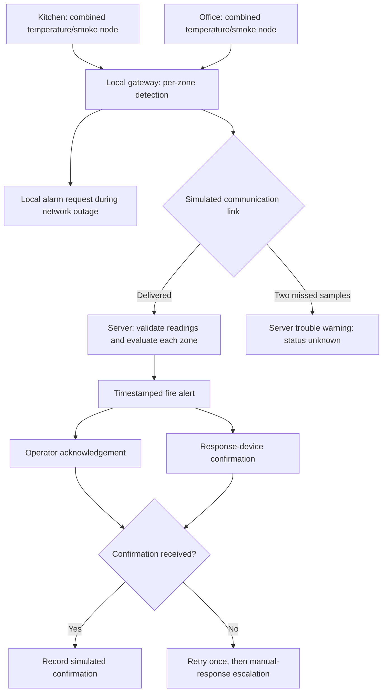

# Integrated Smart Fire Safety

This project has the original console prototype and a connected multi-zone
simulation added for the professor's checkpoint feedback. Existing prototype
files and the sample CSV are preserved. No physical devices or external network
services are used. Python's standard library is sufficient; no packages to install.
Validated with Python 3.12.14.

## Run

From the repository directory:

```bash
python3 -B connected_simulation.py
python3 -B -m unittest discover -s tests -v
```

`-B` prevents Python from writing cache files. To run one scenario:

```bash
python3 -B connected_simulation.py --scenario lost_network
```

To regenerate the checkpoint artifacts (replaces these three generated reports):

```bash
python3 -B connected_simulation.py --output-dir reports
```

Read [the results table](reports/RESULTS.md),
[timestamped output](reports/simulation_output.txt), and
[structured results](reports/simulation_results.json). JSON is a machine-readable
text format that keeps readings, events, and metrics together.

The original two-scenario prototype remains available:

```bash
python3 -B main.py
```

## Files

| File | Purpose |
|---|---|
| `main.py`, `environment.py`, `node.py`, `model.py` | Original random-reading prototype, unchanged |
| `data/fire_sensor_data.csv` | Original six sample rows, unchanged; not consumed by the new scripted scenarios |
| `connected_simulation.py` | New reading format, per-zone detection, gateway/server step, response handling, scenarios, and reports |
| `tests/test_connected_simulation.py` | Automated rule, failure, and metric checks using built-in `unittest` |
| `reports/` | Generated evidence for the checkpoint |
| `config.py`, `requirements.txt`, `README.md~` | Original empty files, unchanged |

## System diagram



The gateway is the component between sensor nodes and the server. Here these
are separate steps in one Python program, not separate running computers.
Every reading and event contains its zone and a timezone-aware timestamp.
Each zone has one combined node providing temperature, smoke, and humidity.
There is no agreement requirement between multiple nodes.

## Alarm rules and assumptions

These rules are teaching design choices, not validated fire-safety settings:

- Trigger: temperature **greater than 60 C AND smoke greater than 50%** for
  **two consecutive valid samples** from the same zone.
- Clear: temperature **at most 50 C AND smoke at most 30%** for two consecutive
  valid samples. Lower clearing limits prevent rapid on/off switching near a
  single limit. This technique is called *hysteresis*.
- A single high sample does not trigger. Exactly 60 C or 50% smoke does not meet
  the trigger rule. Heat alone or smoke alone does not trigger under this design.
- Humidity is recorded but does not participate in the fire rule.
- Missing or invalid samples break a consecutive sequence and never clear an
  active alarm. Sensor validity requires finite numbers, temperature -40 to
  150 C, and smoke/humidity 0 to 100%. These ranges are simulation assumptions.
- Each sample is one virtual second apart. Normal samples are 25 C, 5% smoke,
  50% humidity; fire-like samples are 80 C, 85% smoke, 40% humidity. Failed sensor
  samples have an unavailable (`None`) temperature.
- The synthetic clock starts at 2026-10-21 00:00:00 UTC; this is a fixed test
  reference, not the actual time of a fire or of running the code.
- Connected delivery and successful confirmations have zero simulated latency.
  No network stack, operating-system scheduling delay, or physical device delay
  is modeled. Two zones run for seven virtual seconds per scenario without sleep.

## Scenarios and failure fallbacks

| Scenario | What happens | Fallback / expected behavior |
|---|---|---|
| `normal` | Both zones stay normal | No fire alerts |
| `fire_event` | Kitchen high at seconds 1, 2, 3 | Trigger at second 2; request operator/device response; clear after safe samples at seconds 4 and 5 |
| `failed_sensor` | Kitchen temperature unavailable at seconds 1–3 | Trouble warning, unknown status, inspection/manual monitoring requested; valid samples restore sensor status |
| `lost_network` | Kitchen link unavailable at seconds 1–4, high readings at 1–3 | Local detection continues; local alarm at second 2; server warns after two missed samples, retains any alarm, and requests manual contact. On reconnection at second 5 it receives the retained local alarm before clearing on fresh safe samples |
| `unconfirmed_operator` | Fire-like event; operator confirmation absent | Device confirmation is recorded; retry missing acknowledgement after 1 second, escalate after 2 seconds, retain warning and request manual response |
| `unconfirmed_actuator` | Fire-like event; response-device confirmation absent | Operator acknowledgement is recorded; retry device request after 1 second, escalate after 2 seconds, request manual response and device inspection; never claim the device operated |
| `transient_spike` | One high sample at second 2, no sustained event | No fire alert under the two-sample assumption |

An *actuator* is an output device such as a siren. This simulation represents its
confirmation rather than claiming to operate a real siren, fire door, or HVAC.
An unconfirmed response remains marked in `final_zone_status` after retries stop;
escalation is recorded in the event history, and no later success is invented. Alarm clearing
from sensor data is distinct from confirming that an operator or device responded.

## Interpreting results

- **Simulated first-alert delay**: virtual time from the first labeled fire-like
  sample to the first local or server fire alert.
- **Simulated server-awareness delay**: virtual time until the server raises or
  receives that alarm. During network loss this is longer than the local delay.
- **False fire alarms**: number of fire-raise events in zones without a scripted
  sustained fire. Fault/trouble warnings and synchronization of an existing alarm
  are not new fire alerts. Each scripted fire scenario has one Kitchen event;
  this is not a general multi-incident evaluation dataset.
- **Missed expected fire**: whether an expected scripted event produced no fire
  alert. N/A delay for non-fire cases does not mean a measured zero delay.
- **Measured execution time**: actual elapsed code execution time from Python's
  monotonic timer; it changes between runs. It is separate from all virtual delays.

The small, deliberately separated generated samples can verify implementation
behavior, not real fire-detection accuracy. Zero false alarms here does not imply
zero false alarms in a building. Heat-only/smoke-only events, real sensor noise,
calibration, hardware failure modes, independent node voting, persistent storage,
late/out-of-order messages, security, and real delivery/confirmation protocols
remain outside this simulation. Any real safety system needs separately validated
rules and equipment; do not infer certification from these results.

## Small next steps

1. Review trigger/clear assumptions with the professor before adjusting limits.
2. Add labeled borderline and heat-only/smoke-only cases with expected outcomes.
3. Add CSV playback through the same pipeline and test timestamp/order validation.
4. Add independently simulated nodes per zone only after deciding a voting rule.
